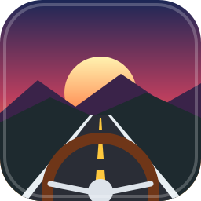

# Horizon Roads 3D (`horizonroads.plm`)

<p align="center">
  
</p>

**Endless scenic 3D road-trip driving game built natively for Ubuntu Touch 24.04 (`OpenGL ES 2.0` + `Qt5` + `Lomiri.Components` + `QtSensors`).**

Inspired by *slowroads.io*, **Horizon Roads 3D** lets you cruise endlessly toward the horizon across changing regions, times of day, and weather — either tilting your phone like a steering wheel or relaxing in **Zen Auto-Drive** behind a lovingly crafted 3D dashboard while procedural synth radio and rain patter play in the cabin.

---

## Highlights

- **6 Procedural Biomes (Auto Road-Trip or Instant Jump):**
  1. **Oregon · Pacific Redwoods** — towering multi-tier conifers & coastal mountain slopes
  2. **Iowa · Heartland Farms** — split-rail fences, red wooden barns, grain silos & spinning windmills
  3. **Arizona · Sonoran Red Rocks** — stepped terracotta mesas & saguaro cacti
  4. **Vermont · Maple Suburbs** — cozy neighborhood houses with glowing evening windows & autumn maples
  5. **Metro · Downtown Skyline** — lit skyscrapers & highway streetlights
  6. **Colorado · Alpine Pass** — snow-blanketed peaks & spruce forests
- **Dynamic Sky & Weather:**
  - Procedural GLSL sky dome with sun, moon, twinkling stars, drifting clouds, directional sunlight, and dual forward headlight cones at night
  - **Clear**, **Rainstorm** (wet road sheen + animated windshield wipers), **Misty Fog**, and **Snowfall**
- **3 Cars (Cockpit Steering-Wheel View, Hood View & 3rd-Person Chase Cam):**
  - **`'68 Canyon Cruiser` (Classic):** Walnut wood fascia, chrome analog dials, 3-spoke mahogany wheel & warm V8 burble
  - **`'94 Nomad Wagon` (Comfy):** Emerald backlit gauges, dashboard coffee cup, rooftop cargo box & hushed touring ride
  - **`Apex GT-RS` (Fun):** Carbon/alcantara cockpit, flat-bottom wheel with red 12-o'clock stripe, digital RPM bar graph & flat-6 wail
- **Controls & Cabin Audio:**
  - **Zen Auto-Drive (`ZEN CRUISE: ON`):** Hands-free lane-keeping & overtaking — drag anywhere on the windshield to look out the side windows, or tap **`HIDE UI`** for pure cinema mode
  - **Tilt Steering (`QtSensors` Accelerometer):** Hold your phone like a wheel with one-tap zero calibration (plus touch-steer fallback)
  - **Real-Time 44.1 kHz C++ Audio Engine:** Speed/RPM-reactive engine synthesis + tire/wind road noise + rain patter + 3 FM synth stations (*92.5 Sunset Chill*, *101.3 Lo-Fi Keys*, *107.9 Horizon Pad*)

---

## Building

### Option A: Native On-Device Build (Ubuntu Touch 24.04 LXC / `devbox`)
```bash
./scripts/build_and_package.sh
mkdir -p release && cd release
click build --no-validate ../click

gdbus call --system --dest com.lomiri.click --object-path /com/lomiri/click \
  --method com.lomiri.click.Install "$PWD/horizonroads.plm_1.0.0_arm64.click"
```

### Option B: Desktop Cross-Build with Clickable
```bash
clickable build --arch arm64
```

---

## License

Released under the [MIT License](LICENSE).
